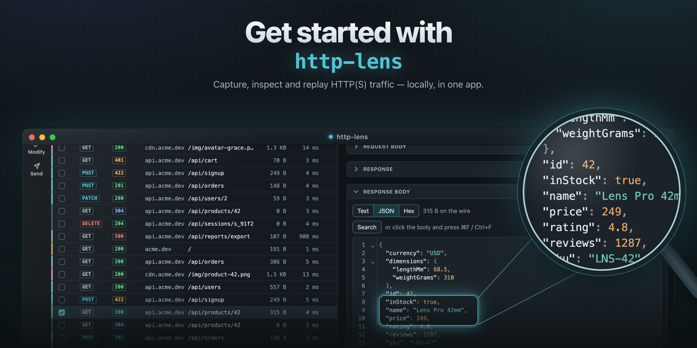

<p align="center">
  
</p>

# http-lens-releases

http-lens release builds (binaries only).

## Install

**macOS**

```sh
curl -fsSL https://github.com/DmitryInc/http-lens-releases/releases/latest/download/install.sh | sh
```

**Windows (PowerShell)**

```powershell
irm https://github.com/DmitryInc/http-lens-releases/releases/latest/download/install.ps1 | iex
```

## macOS: "Apple could not verify http-lens"

If you installed from the `.dmg` and macOS refuses to open the app, run this once in Terminal:

```sh
/usr/bin/xattr -dr com.apple.quarantine /Applications/http-lens.app
```
